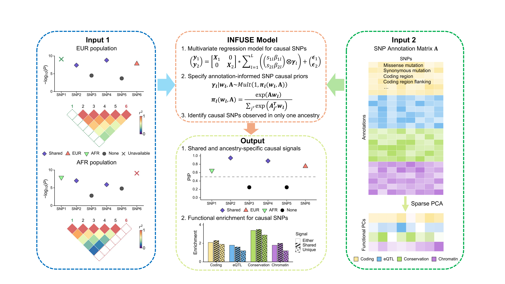

# INFUSE

**INFUSE**: **IN**tegrating **F**unctional annotations into m**U**lti-ancestry fine-mapping via **S**um of single **E**ffect model.



## Overview

INFUSE is an R package for multi-ancestry GWAS fine-mapping using summary statistics. Three key features distinguish it from existing methods:

**Ancestry-specific variant modeling.** INFUSE accommodates variants available in at least one ancestry, including variants polymorphic in only certain populations, enabling broader discovery of shared and ancestry-specific causal signals.

**Functional annotation integration.** INFUSE learns SNP-level causal priors from sparse principal components of high-dimensional functional annotation matrices, such as BaselineLF v2.2. This enables signal-specific prior modeling across hundreds of correlated genomic features while reducing overfitting and improving interpretability.

**Joint LD-discrepancy detection.** INFUSE includes a multi-ancestry diagnostic that jointly detects LD mismatches and allele flips across ancestries before fine-mapping. Compared with applying single-ancestry diagnostics separately, this joint test improves sensitivity while preserving false discovery control.

Simulation and real-data analysis scripts accompanying the manuscript are available at [INFUSE_analysis](https://github.com/gchen4422/INFUSE_analysis), and the detailed tutorial of INFUSE is at [gchen4422.github.io/INFUSE](https://gchen4422.github.io/INFUSE/).

## Installation

```r
# Install devtools if needed
install.packages("devtools")

# Install from GitHub
devtools::install_github("gchen4422/INFUSE")

# Load the package
library(INFUSE)
```

## Example data

The bundled `infuse_availability_example` contains 2,857 variants observed in at least one ancestry
(1,432 available in both ancestries, 124 EUR-only, and 1,301 AFR-only) and 186 annotations.
For unequal variant sets, use `prepare_infuse_union()` to harmonize and align the inputs:

```r
data(infuse_availability_example)
x <- infuse_availability_example

prep <- prepare_infuse_union(
  summary_stat_list = x$summary_stat_list,
  R_mat_list = x$R_mat_list,
  annot = x$annot,
  annot_ids = x$annot_ids,
  union_ids = x$union_ids,
  allele_ref = x$allele_ref,
  ld_allele_coding = "ancestry_effect",
  require_complete_ld_dimnames = TRUE
)

fit <- infuse_core(
  R_mat_list = prep$R_mat_list,
  summary_stat_list = prep$summary_stat_list,
  L = 10,
  annot = prep$annot,
  annot_method = "mlk",
  variant_available = prep$variant_available
)
```

## Core functions

### `infuse_core()`

```r
infuse_core(
  R_mat_list,              # named list of LD correlation matrices by ancestry (SNP x SNP)
  summary_stat_list,       # named list of data.frames with SNP, Beta, Se, Z, N (same SNP order)
  L,                       # integer: max number of causal signals
  residual_variance = NULL,
  prior_weights = NULL,    # optional numeric vector length m (per-SNP prior multipliers)
  ancestry_weight = NULL,  # optional prior weights over ancestry configurations
  optim_method = "optim",
  estimate_residual_variance = FALSE,
  max_iter = 100,
  cor_method = "min.abs.corr",
  cor_threshold = 0.5,
  annot = NULL,            # SNP x feature matrix/data.frame aligned to SNP order
  annot_method = NULL,     # e.g., "mlk" for sparse PCA, "glmnet", or NULL
  est_annot_prior = "fixed",
  variant_available = NULL, # SNP x ancestry indicator of variant availability
  verbose = TRUE
)
```

#### Arguments

- **`R_mat_list`**  
  Named list of ancestry-specific **LD correlation matrices** (symmetric; identical SNP IDs and identical SNP order across ancestries after union preparation). Use `prepare_infuse_union()` for unequal observed variant sets.

- **`summary_stat_list`**  
  Named list of GWAS summary-stat data.frames aligned to LD. Required columns: `SNP`, `Beta`, `Se`, `Z`, `N`. Effect alleles must be harmonized across ancestries. List names must match those of `R_mat_list`.

- **`L`**  
  Integer: maximum number of causal signals to model for the region.

- **`residual_variance`**  
  Numeric or `NULL`. If `NULL`, use default or estimate when `estimate_residual_variance = TRUE`.

- **`prior_weights`**  
  Optional numeric vector of length *m* (per-SNP prior multipliers), aligned to SNP order.

- **`ancestry_weight`**  
  Optional numeric vector of prior weights over the `2^K - 1` nonempty ancestry configurations, where `K` is the number of ancestries. For two ancestries, the default weights are `c(3, 3, 1)/7` for the two ancestry-specific configurations followed by the shared configuration. With unequal variant availability, these weights are renormalized over the permitted configurations for each SNP.

- **`optim_method`**  
  Optimizer choice (default `"optim"`).

- **`estimate_residual_variance`**  
  Logical. If `TRUE`, estimate residual variance.

- **`max_iter`**  
  Integer: maximum optimization iterations.

- **`cor_method`, `cor_threshold`**  
  Credible-set purity criterion and threshold (defaults `"min.abs.corr"` and `0.5`).

- **`annot`**  
  Annotation matrix/data.frame (SNP × features), rows aligned to SNP order.

- **`annot_method`**  
  How to use annotations (e.g., `"mlk"` for sparse PCA, `"glmnet"`, or `NULL`).

- **`est_annot_prior`**  
  Annotation-prior mode (`"fixed"` or `"optim"`).

- **`variant_available`**
  Optional logical SNP-by-ancestry matrix specifying where each variant is available for fine-mapping (`TRUE` = available). This allows variants available in only a subset of ancestries to contribute to causal discovery. Rows follow SNP order, and column names match the ancestry list names. `NULL` assumes all variants are available in all ancestries.

- **`verbose`**
  Logical. Whether to print progress (default `TRUE`).

---

### `kriging_rss_joint()` — Joint multi-ancestry LD-discrepancy test

Run this before `infuse_core()` to flag and remove variants with LD mismatches or allele flips. Unlike single-ancestry diagnostics, it stacks z-scores from both ancestries into a joint model, giving higher sensitivity.

```r
# Run diagnostic
diag <- kriging_rss_joint(z_eur, z_afr, R_eur, R_afr, n1 = 193593, n2 = 60760)
diag$plot  # inspect; red points = candidate mismatches

# Remove flagged SNPs
bad_snps <- diag$conditional_dist$logLR_joint > 2 &
            abs(diag$conditional_dist$z_std_diff) > 4
clean_idx <- which(!bad_snps[seq_along(z_eur)])
```

---

## Runtime and reproducibility notes

INFUSE may rely on numerical linear algebra routines that use multi-threaded BLAS, LAPACK, or OpenMP backends. On shared computing environments, such as HPC clusters, uncontrolled multi-threading can lead to CPU oversubscription, unstable runtime, and small numerical differences across runs.

To improve runtime stability and numerical reproducibility, we recommend limiting the number of threads used by common linear algebra backends before running INFUSE.

For shell-based workflows or Slurm jobs, add the following lines before launching R:

```bash
export OPENBLAS_NUM_THREADS=1
export OMP_NUM_THREADS=1
export MKL_NUM_THREADS=1
export VECLIB_MAXIMUM_THREADS=1
export NUMEXPR_NUM_THREADS=1
```

For example, in a Slurm job script:

```bash
#!/bin/bash
#SBATCH --job-name=infuse
#SBATCH --cpus-per-task=1
#SBATCH --mem=16G
#SBATCH --time=24:00:00

export OPENBLAS_NUM_THREADS=1
export OMP_NUM_THREADS=1
export MKL_NUM_THREADS=1
export VECLIB_MAXIMUM_THREADS=1
export NUMEXPR_NUM_THREADS=1

Rscript run_infuse.R
```

For RStudio, these variables can be set before loading INFUSE:

```r
Sys.setenv(
  OPENBLAS_NUM_THREADS = "1",
  OMP_NUM_THREADS = "1",
  MKL_NUM_THREADS = "1",
  VECLIB_MAXIMUM_THREADS = "1",
  NUMEXPR_NUM_THREADS = "1"
)

library(INFUSE)
```

For repeated analyses, we recommend adding these settings to an `.Renviron` file so they are applied automatically when R starts:

```bash
OPENBLAS_NUM_THREADS=1
OMP_NUM_THREADS=1
MKL_NUM_THREADS=1
VECLIB_MAXIMUM_THREADS=1
NUMEXPR_NUM_THREADS=1
```

These settings are especially useful when running many loci in parallel, where each job should typically use a single computational thread unless the user explicitly allocates additional CPUs per task.

## Citation

If you use INFUSE in your research, please cite:

> Chen G, et al. INFUSE improves multi-ancestry fine-mapping through high-dimensional functional annotation integration and robust LD discrepancy detection. *In preparation*.

