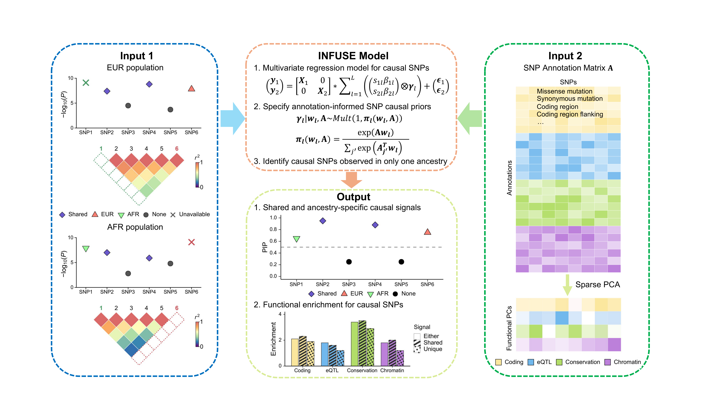

## INFUSE Overview

INFUSE (**IN**tegrating **F**unctional annotations into m**U**lti-ancestry fine-mapping via **S**um of single **E**ffect model) is an R package for statistical fine-mapping of causal genetic variants using GWAS summary statistics from multiple ancestry groups. INFUSE extends the MESuSiE ([Gao et al., 2024](https://doi.org/10.1038/s41588-023-01604-7)) framework to jointly model shared and ancestry-specific causal signals while leveraging functional genomic annotations to improve variant prioritization.

## Motivation

Multi-ancestry fine-mapping can improve causal variant discovery by leveraging population differences in LD and allele frequencies. However, existing methods remain limited in their ability to identify causal variants polymorphic only in certain populations, incorporate high-dimensional functional annotations, and account for mismatches between GWAS summary statistics and external LD references. INFUSE addresses these challenges through three features:

1. **Ancestry-specific variant modeling:** INFUSE includes variants available in at least one ancestry, including variants polymorphic in only certain populations, while distinguishing shared from ancestry-specific causal signals.

2. **Functional annotation integration:** INFUSE integrates high-dimensional functional annotations through sparse PCA and learns signal-specific priors to improve causal variant prioritization and fine-mapping resolution.

3. **Joint LD-discrepancy detection:** A joint multi-ancestry diagnostic identifies inconsistencies between GWAS summary statistics and LD reference panels.

## When to Use INFUSE

INFUSE can be used when:

- You have GWAS summary statistics from **2 or more ancestry groups** at a locus of interest
- You have **ancestry-matched LD matrices** estimated from in-sample genotypes or external reference panels.
- Your locus may contain **shared or ancestry-specific causal signals**, including variants available in only one ancestry
- You have **functional annotation data** for the variants in the region (e.g: BaselineLF reference from PolyFun ([Weissbrod et al., 2022](https://www.nature.com/articles/s41588-020-00735-5)))

> **Note:** INFUSE is intended strictly for research purposes. Results should be interpreted in the context of study design, population structure, and the quality of input data.
